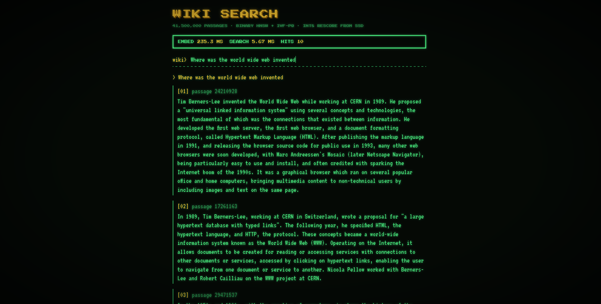

# wiki-hybrid-retrieval

Semantic search over all of English Wikipedia (41.5M passages) on a single laptop, in about 4 ms at p99.



## Numbers

Measured on the 3,610 NQ-open validation questions, one query at a time, with a cold page cache. Latency is the median of 5 runs and covers retrieval only, from the query vector to the top 10 passage ids.

| | |
|---|---|
| p50 | **2.66 ms** |
| p95 | **3.24 ms** |
| p99 | **3.96 ms** |
| recall@10 against exact search | 0.956 |
| answer accuracy@10 | 77.23% (exact search: 78.20%) |
| RAM while serving | about 18 GiB |
| int8 vectors | 42.5 GB, read from the SSD |

These are numbers for continuous queries. On the search page each query first waits for the Cohere embedding call, and retrieval then takes about 7 to 11 ms, because the CPU caches go cold between queries. Embedding the query with Cohere's API takes another 180 to 450 ms or so.

How the setup was chosen, with every algorithm tried and its numbers, is in [benchmark/README.md](benchmark/README.md).

## How it works

1. The query is embedded with Cohere `embed-multilingual-v3.0`, the same model that embedded the passages, as int8 and binary vectors.
2. Two approximate indexes search in parallel threads.
   - **Binary HNSW** (USearch, 1-bit vectors, Hamming distance, M=16) keeps its best 250 passages.
   - **IVF-PQ fast-scan** (FAISS, 65,536 cells, 64-byte codes) scans 128 cells and keeps its best 200.
3. The two lists are merged (about 371 passages) and rescored with exact int8 dot products. The int8 vectors stay on the SSD, and the ~371 rows are read with parallel `posix_fadvise` hints.
4. The top 10 are returned with their text.

At these settings neither index is enough on its own (IVF-PQ alone peaks at recall 0.915 at 41.5M). They miss different passages, so together they pass.

`api/main.py` is a FastAPI server that holds both indexes in memory and serves the search page from `web/` (React).

## Running it

**You need** Linux, Python 3.12 with [uv](https://docs.astral.sh/uv/), Node.js, a free [Cohere](https://cohere.com) API key, an NVMe SSD with about 140 GB free, and a machine with 32 GiB of RAM (about 22 GiB free while building, 18 GiB while serving).

| Step | Command | Time | Peak RAM | Disk |
|---|---|---|---|---|
| 1. Download passages and vectors | `make download-wiki` | depends on your connection | small | 58 GB |
| 2. Write the corpus files | `make full` | ~3 min | ~11 GiB | 64 GB |
| 3. Build the two indexes | `make winner` | ~1.6 h | ~22 GiB | 15 GB |
| 4. Serve the search page | `make serve` | 20 to 30 s to load | ~18 GiB | |

Before step 4, put the key in `.env` as `COHERE_KEY=...`. Then open http://127.0.0.1:8000. `make` lists all targets, and `requirements.txt` pins the Python packages for pip users.

## Layout

```
api/          FastAPI server (search + page)
web/          React search page
scripts/      corpus files (make_full.py) and index build (build_winner.py)
benchmark/    everything used to choose the setup: scripts, results, charts, its own Makefile and README
```

## Data

- **Passages and vectors:** [Cohere's Wikipedia 2023-11 embeddings](https://huggingface.co/datasets/CohereLabs/wikipedia-2023-11-embed-multilingual-v3-int8-binary) (`embed-multilingual-v3.0`, int8 and binary), English config. Thanks to Cohere for publishing them.
- **Wikipedia text:** © Wikipedia contributors, from Wikimedia, under [CC BY-SA](https://creativecommons.org/licenses/by-sa/4.0/).
- **Questions:** [NQ-open](https://huggingface.co/datasets/google-research-datasets/nq_open) from Google's Natural Questions, under CC BY-SA. Questions were embedded with the same Cohere model.
