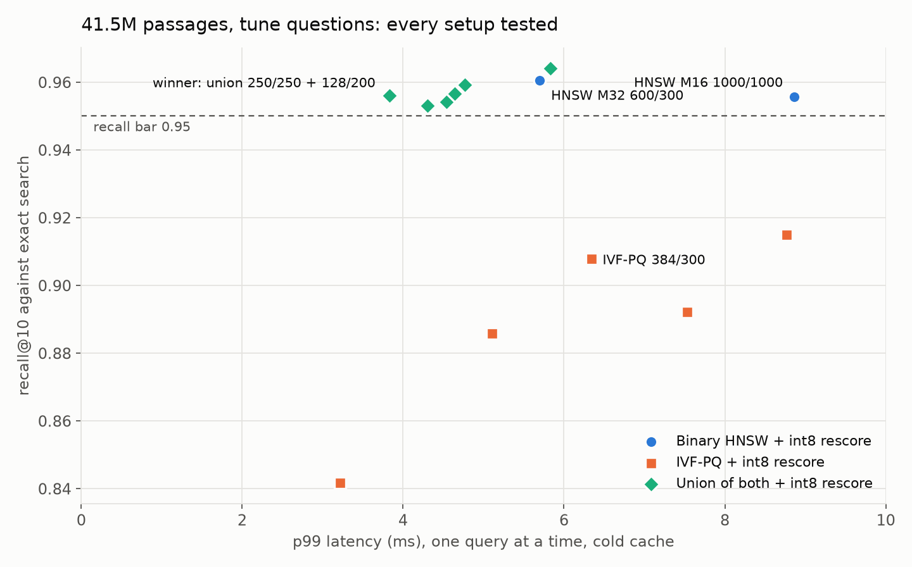
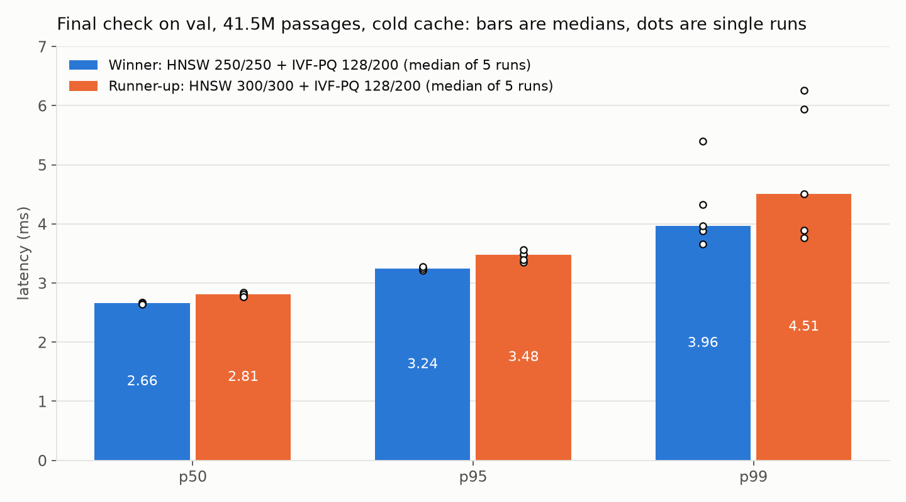

# Benchmarks

How the search setup was chosen: every algorithm tried, its numbers, and why it was kept or dropped. Every run is a row in [results/results.csv](results/results.csv), with its per-question latencies in `results/latencies/`.

## 1. Setup

### Machine

| | |
|---|---|
| CPU | AMD Ryzen AI Max+ 395, 16 cores / 32 threads, 64 MB L3 |
| Memory | 32 GiB unified memory shared with the iGPU (Radeon 8060S, unused here). A 4 GiB UMA buffer is reserved for the iGPU, so Linux sees 27.0 GiB. |
| SSD | WD_BLACK SN770M 2 TB NVMe, DRAM-less. fio: ~400k random 4 KB reads/s at high queue depth, 68 µs for a single read. |
| OS | Bazzite (Fedora-based), Linux 7.2, btrfs, zram swap |

### Data

- **Passages:** Cohere's Wikipedia 2023-11 English embeddings, 41,488,110 passages. Each has an int8 vector (1,024 dims, 1 KB) and a binary vector (128 bytes).
- **Questions:** NQ-open, embedded once with the same Cohere model. **tune** is 3,000 random train questions, used to pick settings. **val** is all 3,610 validation questions, used to report.

Sizes of files are in GB (10⁹ bytes) and RAM in GiB.

### Rules

- **Two checks against exact search on the same vectors.**
  - recall@10 ≥ 0.95
  - answer accuracy@10 at most 1 point below exact search. Accuracy is the share of questions where a top-10 passage contains an answer string, after SQuAD-style normalisation.
- **Lowest p99 wins** among the setups that pass.
- **Timing.**
  - One question at a time, after 50 warm-up questions.
  - The timer covers the query vector to the final 10 ids. Embedding the question is not included.
  - Each index search runs on one thread.
- **Cold cache.** At 41.5M the int8 vectors are read from SSD, and `cache=cold` evicts them from the page cache after the warm-up.
- **Median of 5 for the final check.** A single run's p99 moves by 1 to 2 ms because of the SSD's slow reads.

## 2. Slicing

Algorithms were compared on a 5M slice first, because builds and sweeps take minutes there instead of hours.

- **Whole articles, sampled across the corpus.** A slice keeps every article with `article_id % 1000 < K`.
  - 1M: K=24, 1,004,611 passages
  - 5M: K=120, 4,981,917 passages from 701,023 articles

  Slices nest, articles are never split, and old and new articles are both covered.
- **Not the first files.** The raw files are blocks of articles in id order. The first 10 files hold only articles created around 2007 and miss most of the popular articles that NQ asks about.
- **Exact search accuracy grows a lot with corpus size,** so each slice has its own bar.

| Exact int8 search, val | 1M | 5M | 41.5M |
|---|---|---|---|
| accuracy@10 | 32.22% | 47.92% | 78.20% |
| accuracy@20 | 38.12% | 53.74% | 81.88% |
| accuracy@100 | 50.06% | 64.63% | 87.67% |

At 41.5M this is in line with DPR's reported 78.4% @20 and 85.4% @100 on its 21M-passage Wikipedia.

Exact search at 5M (USearch brute force, one thread) takes 315 ms p50 and 330 ms p99 per question. That's the speed to beat.

## 3. Algorithms at 5M

Bars on 5M: val accuracy ≥ 46.92%, tune accuracy ≥ 44.13%, recall ≥ 0.95. All vectors are in RAM. The best passing setting is shown for each.

| Setup | Best setting | Set | Recall | Accuracy | p99 | Index file at 5M | Decision |
|---|---|---|---|---|---|---|---|
| Exact int8 | | val | 1.000 | 47.92% | 330 ms | | reference |
| Binary scan + int8 rescore | depth 300 | val | 0.964 | 47.98% | 17.7 ms | | dropped |
| int8 HNSW (USearch) | M32 ef128 | val | 0.955 | 47.06% | 1.48 ms | 6.1 GB | dropped |
| IVF, int8 lists (FAISS) | 16,384 cells, HNSW centres, nprobe 384 | tune | 0.956 | 44.37% | 5.91 ms | 4.9 GB | dropped |
| IMI 2×10 (FAISS) | nprobe 16,384 | tune | 0.966 | 44.63% | 16.1 ms | | dropped |
| BM25 (Tantivy) | built-in English stop words | tune | | 28.80% | 12 ms | | optional |
| **Binary HNSW + int8 rescore** | M32, ef 600, depth 300 | val | 0.950 | 47.40% | 3.01 ms | 1.9 GB | kept |
| **Binary HNSW + int8 rescore** | M16, ef 1000, depth 1000 | val | 0.960 | 47.15% | 3.65 ms | 1.3 GB | kept |
| **IVF-PQ fast-scan + int8 rescore** | 16,384 cells, PQ128x4fs, nprobe 384, depth 1000 | tune | 0.954 | 44.37% | 3.02 ms | 0.42 GB | kept |
| **Union of the two** | HNSW M16 200/200 + IVF-PQ 128/200 | val | 0.958 | 47.15% | **1.35 ms** | ~1.7 GB | kept, lead |

### Dropped

- **Binary scan + rescore.** It's accurate, but it scans every passage, so cost grows with the corpus (about 8× at 41.5M).
- **int8 HNSW.** It was the fastest single index at 5M, but its graph plus vectors (6.1 GB at 5M) would be about 51 GB at 41.5M, against 27 GiB of RAM.
- **IVF with int8 lists.** It needs nprobe 384 (about 117k vectors, 120 MB per question) to reach recall 0.95, and the scan is limited by memory bandwidth (about 44 ns per vector). That's about 4× slower than int8 HNSW, and the lists would hold all 42.5 GB of int8 at 41.5M.
- **IMI.** Its cells are very uneven, so the tail is long (p99/p50 up to 1.95) and passing needs a huge nprobe.
- **BM25 (kept as optional).** Only 2.97% of tune questions are answered by BM25 and not by dense search. The top 20 from dense search (50.33%) beats the top 10 from dense plus the top 10 from BM25 (48.10%). It's also about 10× slower than the dense candidates. It's worth rechecking at 41.5M, where it wasn't tested.

### Kept

- **Binary HNSW + int8 rescore.** The 1-bit graph is 3 to 5× smaller than int8 HNSW and fits at 41.5M (11.5 GB for M16, 16.8 GB for M32). The rescore reads only `depth` int8 rows, which can come from SSD.
- **IVF-PQ fast-scan + int8 rescore.** 64-byte codes per passage, so 12× smaller than int8 lists at about half the p99. Its tail is steady (p99/p50 1.1 to 1.3).
- **The union.** Two near-misses, binary HNSW M16 300/300 (recall 0.905) and IVF-PQ 128/300 (0.890), reach 0.967 together on tune. They miss different passages: 200 + 200 candidates merge to about 328, so only about 72 passages are shared. They run in parallel threads and are rescored once. The cheapest passing union (HNSW 200/200 + IVF-PQ 128/200) reaches recall 0.958 at 1.35 ms p99 on val. That beats int8 HNSW (1.48 ms), and it fits in RAM at 41.5M.

## 4. Scaling to 41.5M

### Builds

| | Time | Index | Peak RAM |
|---|---|---|---|
| Corpus files (`make full`: int8, binary, text) | 3 min | 63.7 GB on disk | 10.6 GiB |
| Exact ground truth (top 100, tune + val) | 16 min | | 16.1 GiB |
| Binary HNSW M16 | 13 min | 11.5 GB | 17.3 GiB |
| Binary HNSW M32 | 20 min | 16.8 GB | 21.6 GiB |
| IVF65536-PQ128x4fs (1.3M training sample, HNSW over centres) | 83 min (61 min training) | 3.3 GB | 22.0 GiB |

### Reading the int8 rows from SSD

The int8 vectors (42.5 GB) don't fit next to the indexes, so the rescore reads its candidates' random 1 KB rows from the SSD: 300 to 1,000 per question depending on the setup, about 371 for the winner. The file is page-aligned, so each row sits inside one 4 KB page.

| 413 random rows, cold | p50 | p99 |
|---|---|---|
| memory-mapped gather, no hints (one page fault at a time) | 30.0 ms | 32.0 ms |
| `posix_fadvise(WILLNEED)` per row, then gather, 1 thread | 1.75 ms | 2.40 ms |
| **same, fadvise split over 4 threads** | **1.39 ms** | **1.88 ms** |
| same, 8 threads | 1.38 ms | 3.84 ms |

- **fadvise queues every read at once,** so the SSD serves them in parallel.
- **Each cold fadvise costs ~3 µs in the kernel,** for page allocation and read submission. That's why splitting the calls over 4 threads helps.
- **~1.4 ms is close to this drive's floor.** At ~400k reads/s, 413 reads take at least ~1.1 ms. We reach 75 to 80% of that.

### Results on tune

Cold cache. Bars are recall 0.95 and accuracy 76.33% (exact search 77.33%). These runs used fadvise on one thread, except the 250/250 union (4 threads).

| Setup | Setting | Recall | Accuracy | p50 | p99 (ms) | Passes |
|---|---|---|---|---|---|---|
| Binary HNSW | M32, ef 600, depth 300 | 0.961 | 76.57% | 4.11 | 5.70 | yes |
| Binary HNSW | M16, ef 1000, depth 1000 | 0.956 | 76.33% | 6.23 | 8.86 | yes, on the bar |
| IVF-PQ | nprobe 128, depth 300 | 0.842 | 74.53% | 2.47 | 3.22 | no |
| IVF-PQ | 256 / 300 | 0.886 | 75.93% | 3.66 | 5.11 | no |
| IVF-PQ | 256 / 1000 | 0.892 | 75.97% | 5.36 | 7.53 | no |
| IVF-PQ | 384 / 300 | 0.908 | 76.33% | 4.81 | 6.34 | no (recall) |
| IVF-PQ | 384 / 1000 | 0.915 | 76.27% | 6.60 | 8.77 | no |
| Union | HNSW 200/200 + IVF-PQ 128/200 | 0.953 | 76.47% | 2.97 | 4.30 | yes |
| Union | 200/200 + 128/300 | 0.954 | 76.47% | 3.18 | 4.54 | yes |
| Union | 250/250 + 128/200 | 0.956 | 76.57% | 2.64 | 3.83 | yes |
| Union | 300/300 + 96/200 | 0.957 | 76.53% | 3.07 | 4.64 | yes |
| Union | 300/300 + 128/200 | 0.959 | 76.70% | 3.15 | 4.77 | yes |
| Union | 400/400 + 128/300 | 0.964 | 76.70% | 3.96 | 5.83 | yes |



- **IVF-PQ alone loses recall at 41.5M** (best 0.915, against 0.954 at 5M). It's still the lowest-memory option, at about 6.5 GiB in use.
- **Five of the six unions pass at a lower p99 than the best single index** (binary HNSW M32, 5.70 ms).
- **IVF-PQ is the slower half of the union.** Searches only: HNSW 200 alone takes 0.64 ms p50, IVF-PQ 128 alone 1.30 ms, and both in parallel 1.27 ms. So a deeper HNSW side is almost free.

### Unions on val

4-thread fadvise, single runs. Bars are recall 0.95 and accuracy 77.20%.

| Union | Candidates | Recall | Accuracy | p50 | p99 (ms) |
|---|---|---|---|---|---|
| 200/200 + 128/200 | 329 | 0.9525 | 77.17% ✗ (1 question short) | 2.53 | 3.27 |
| 200/200 + 128/300 | 415 | 0.954 | 77.17% ✗ | 2.81 | 5.31 |
| 250/250 + 128/200 | 371 | 0.956 | 77.23% ✓ | 2.71 | 6.23 |
| 300/300 + 96/200 | 414 | 0.956 | 77.06% ✗ | 2.62 | 5.72 |
| 300/300 + 128/200 | 413 | 0.959 | 77.29% ✓ | 2.80 | 4.26 |
| 400/400 + 128/300 | 577 | 0.964 | 77.31% ✓ | 3.36 | 6.95 |

- **Accuracy is the check that binds on val.** The fastest union misses by one question.
- **A single run's p99 is noisy.** p50 is steady, but 1 to 3% of queries hit the SSD's slow reads, more often with more candidates. So the two passing candidates were run 5 times each, alternating.

### Final check: 5 runs each on val



| Union | p50 | p95 | p99 (median of 5) | p99 range |
|---|---|---|---|---|
| **250/250 + 128/200** | **2.66** | **3.24** | **3.96** | 3.66 to 5.40 |
| 300/300 + 128/200 | 2.81 | 3.48 | 4.51 | 3.76 to 6.26 |

250/250 is faster at every percentile, including p50 and p95, which the SSD noise doesn't affect. Both pass accuracy only narrowly, by 1 and 3 questions.

## 5. Winner

**Union of binary HNSW (M16, ef 250, depth 250) and IVF65536-PQ128x4fs (nprobe 128, depth 200),** searched in parallel. The ~371 merged candidates are rescored with int8 read from SSD, with fadvise over 4 threads.

| val, 3,610 questions, cold cache, median of 5 | |
|---|---|
| p50 / p95 / p99 | **2.66 / 3.24 / 3.96 ms** |
| recall@10 | 0.956 |
| accuracy@10 | 77.23% (exact 78.20%, bar 77.20%) |
| index files | 14.8 GB (11.5 HNSW + 3.3 IVF-PQ) |
| RAM while serving | ~18 GiB |

Where the time goes. Stage timing of the 300/300 union with fadvise on one thread, p50: 1.43 ms for the two searches in parallel, 0.17 ms to merge, 1.39 ms to read the rows from SSD, 0.04 ms to rescore. Four fadvise threads cut the reads by ~0.35 ms.

### Caveats

- **Continuous queries only.** With gaps between queries, as on the search page, retrieval takes about 7 to 11 ms because the CPU caches go cold.
- **Memory is tight.** 18 GiB of 27 GiB. Under pressure, zram swap compresses parts of the indexes and searches jump to tens or hundreds of ms.
- **BM25 and filtered search** were not tested at 41.5M.

## Rerunning

Everything runs from the repo root through `make -C benchmark` (list the targets with `make -C benchmark`).

```
make -C benchmark download-nq embed-questions        # questions (needs COHERE_KEY in .env)
make -C benchmark slice K=120 SLICE=5m               # 5M slice
make -C benchmark baseline SLICE=5m                  # exact ground truth + accuracy
make -C benchmark bench SLICE=5m SETUP=ivf           # int8 IVF; its centres are reused by IVF-PQ at 5M
make -C benchmark bench SLICE=5m SETUP=union PARAMS="h.M=16 h.ef=200 h.depth=200 i.coarse=hnsw i.nprobe=128 i.depth=200" QSET=val
make -C benchmark bench-winner                       # the winner at 41.5M (needs make full + make winner)
make -C benchmark charts                             # redraw the charts from results.csv
```

`results/results.csv` has one row per run: setup and params, question set, recall@10, accuracy@10 (and @20 when `k=20`), p50/p95/p99/mean latency, build time and peak RSS.
